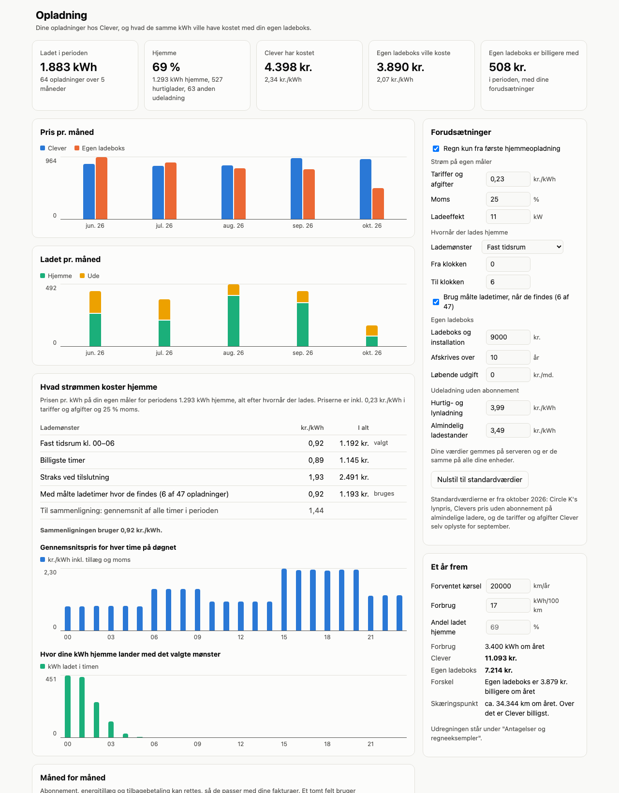
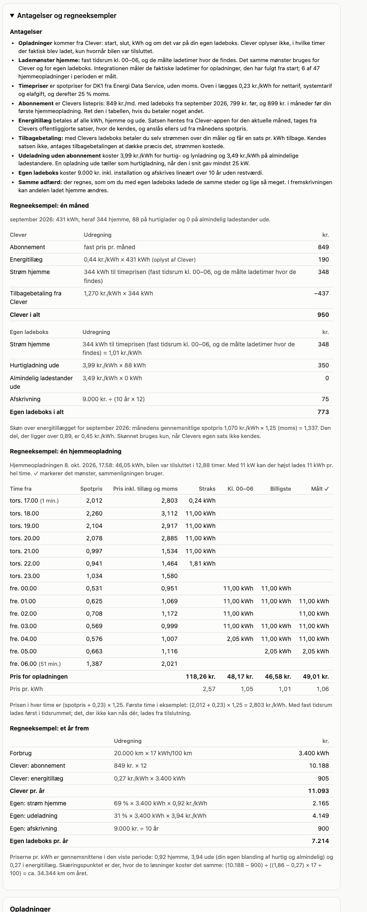

# Clever API

Unofficial Home Assistant custom integration for Clever subscriptions and home
chargers. This project is not affiliated with or supported by Clever A/S.

This is a fork of [mindThomas/clever_api](https://github.com/mindThomas/clever_api)
that adds price figures for comparing Clever with other electricity prices, a
read-only mode, slower polling when no car is connected, Danish translations,
and a sidebar page that compares Clever with owning the charger yourself.

The integration follows the API used by the current Clever Android app:

- Firebase email/password authentication and refresh tokens
- Clever mobile backend API v6
- Cloud Firestore live home-charger state and active transactions

## Prerequisite

Create or migrate your Clever account in the official Clever app first. Account
creation, email verification, SMS verification, and CRM claim migration are not
implemented in this integration.

## Installation and login

Add `https://github.com/memilnie/clever_api` to HACS as a custom repository of
type Integration, install a release, restart Home Assistant, and add
**Clever API** from **Settings → Devices & services**.

New accounts are set up **read-only**: Home Assistant only reads data, and no
switches or control actions are created. Turn this off under the integration's
options to add the preheat and boost switches and the intelligent-charging
actions. Entries created before 0.5.0 keep their controls.

Enter the email and password used in the Clever app. The password is used for
the initial Firebase login and is not stored in the Home Assistant config entry.
Home Assistant stores the resulting Firebase refresh token, which must be
treated as a sensitive credential.

Existing version 0.2 entries are migrated to the new entry format and prompt
for reauthentication because the former email-link token cannot be converted
to a Firebase refresh token.

## Entities

All accounts expose:

- Energy this month
- Energy surcharge (the rate in DKK/kWh)
- Energy surcharge this month (the rate times this month's consumption)
- Monthly subscription fee
- Estimated total price this month (subscription fee plus surcharge)
- Effective price per kWh this month

Accounts with a home charger additionally expose:

- Energy this month on the home charger
- Energy in the current charging session
- Target energy and progress for the current charging session
- Charging-session duration and average delivered power
- Expected charging completion and vehicle battery level when available
- Charging and vehicle-connected binary sensors
- Live charger state
- Intelligent-charging status and configuration attributes
- Preheat switch (not in read-only mode)
- Skip-intelligent-charging (boost) switch (not in read-only mode)

## Comparing Clever with other electricity prices

Clever charges a fixed monthly subscription fee and, in months where the
average purchase price of electricity is above 0.89 DKK/kWh, an **energy
surcharge** on every kWh charged at home and on the network. The surcharge rate
for the month comes from Clever. The subscription fee is not available from the
API, so it is a setting: the default is 849 DKK, the price of Clever One with a
home charger from 1 September 2026 (999 DKK without one).

**Effective price per kWh this month** puts those two costs on the same scale
as other electricity prices:

    (subscription fee × share of the month that has passed + surcharge so far)
    ÷ kWh charged so far

The fee is counted in proportion to the elapsed part of the month, so the
figure is meaningful from the first charge rather than only on the last day.
On the last day it equals the full month's cost per kWh. It is unknown until
something has been charged in the month.

With a home charger, the electricity itself goes through your own meter and
Clever refunds it at a monthly rate. That refund and your own electricity bill
are not part of these figures. The effective price is therefore what Clever
costs on top, on the assumption that the refund covers what the electricity
cost you.

## Charging overview: Clever compared with a charger of your own

The integration adds a page called **Opladning** to the Home Assistant sidebar.
It lists what you have charged and compares what Clever has cost with what the
same energy would have cost if you owned the charger yourself. The page is in
Danish.

The page shows:

- energy charged, the share charged at home, and the split between fast
  charging and ordinary public chargers away from home
- cost per month for Clever and for a charger of your own
- a month-by-month table where the subscription fee, the energy surcharge rate
  and the refund rate can be corrected to match your invoices
- a projection for a year at an expected mileage, with the mileage at which the
  two solutions cost the same
- what a kWh costs at home under each charging pattern, the average price of
  each hour of the day, and the hours your home charging lands in
- every charging session with what it would have cost on your own meter

Everything is calculated in the browser from your sessions and hourly
electricity prices, so changing an assumption updates the figures at once. The
assumptions are saved in Home Assistant, so they are the same on all your
devices, and can be reset to the defaults on the page.

The screenshots use made-up data. To try the page without Home Assistant, serve
the repository over HTTP (`python3 -m http.server`) and open `docs/demo.html`.

### Assumptions

| Assumption | Default | Where it comes from |
|---|---|---|
| Hourly electricity price | Day-ahead price for your price area | Energi Data Service, `DayAheadPrices`, without VAT |
| Tariffs and duties on your own meter | 0.23 DKK/kWh | Net tariff, system tariff and electricity duty as stated by Clever for September 2026 |
| VAT | 25 % | |
| Charging power | 11 kW | |
| When home charging takes place | A fixed window, 00–06 | Alternatives: the cheapest hours while connected, or from plug-in. Measured hours are used where they exist |
| Subscription fee | 849 DKK from September 2026, 799 before, 899 in months before your first home charge | Clever One list prices |
| Energy surcharge | Rate from the Clever app for the current month, Clever's published rate where known, otherwise estimated | Estimate: month's average spot price × 1.25, minus 0.89 DKK/kWh |
| Refund of home electricity | Clever's published rate where known | Without a rate, the refund is taken to cover exactly what the electricity cost |
| Fast charging away from home | 3.99 DKK/kWh | Circle K, October 2026 |
| Ordinary public charger | 3.49 DKK/kWh | Clever without a subscription, October 2026 |
| Own charger incl. installation | 9,000 DKK over 10 years | Straight-line depreciation, no residual value |

Three things the calculation cannot know:

- Clever reports when the car was connected, not the hours in which it actually
  charged. You therefore choose a charging pattern: a fixed window of the day
  (for example at night), the cheapest hours while connected, or from the
  moment of connection. The page shows the price per kWh for each of them.
- From version 0.8.0 the integration follows the running session and records
  the energy delivered in each hour. Those measured hours are used instead of
  the pattern for the sessions that have them. Sessions from before 0.8.0, and
  sessions already under way when Home Assistant started, have none.
- A session away from home is counted as fast charging when it averaged at least
  25 kW.
- The comparison assumes you would have charged in the same places with a
  charger of your own. In the projection, the share charged at home can be
  changed.

### How it is calculated

For each month:

    Clever       = subscription fee
                 + surcharge rate × all kWh
                 + (home electricity at hourly prices − refund rate × home kWh)   if the refund rate is known

    Own charger  = home kWh at hourly prices
                 + fast kWh away × fast price + other kWh away × public price
                 + charger price ÷ (years × 12) + running cost

The price of a kWh at home in a given hour is `(spot price + tariffs and duties) × (1 + VAT)`.
The same charging pattern is used for both solutions. With a fixed window, the
energy is placed in the window's hours while the car was connected; what does
not fit there is charged from the moment of connection.

For a year ahead, with the averages of the period shown:

    kWh per year = km × kWh per 100 km ÷ 100
    Clever       = 12 × fee + average surcharge × kWh per year
    Own charger  = home share × kWh × average home price
                 + (1 − home share) × kWh × average price away
                 + charger price ÷ years + 12 × running cost

The break-even mileage is where the two are equal.

The page writes these calculations out with your own numbers under
**Antagelser og regneeksempler**: one month, one home charging session hour by
hour, and the year ahead.

### Settings

Under the integration's options:

- **Show the charging overview in the sidebar** turns the page on or off.
- **Electricity price area** is DK1 (west of the Great Belt) or DK2. It is
  chosen from Home Assistant's location until you set it.

Hourly prices are fetched from `api.energidataservice.dk` every few hours and
kept in `.storage/clever_api.prices.<entry id>`. The assumptions you enter are
kept in `.storage/clever_api.charging_settings.<entry id>`. Both are deleted
when the account is removed.

## Charging history

Completed charging sessions (start, stop, energy, charge point and whether it
was the home charger), the energy recorded per hour while a home session was
running, and each month's energy surcharge rate are kept in
`.storage/clever_api.history.<entry id>` in the Home Assistant configuration
folder. Sessions are added as Clever reports them and are kept after they drop
out of Clever's response. The file is deleted when the account is removed from
Home Assistant.

## Actions

The actions are only available when at least one account is not read-only.

- `clever_api.enable_flex` sets `departure_time` (hh:mm) and `required_energy`
  (kWh), then enables the home charging profile.
- `clever_api.disable_flex` disables the home charging profile.

The earlier field names `depature_time` and `desired_range` and the legacy
`phase_count` input remain accepted so existing automations keep working. API
v6 does not expose a charging-profile setting for phase count.

## Update intervals

Consumption, surcharge, installations, and charging profiles refresh hourly.

Live chargepoint state and transaction documents refresh every minute while a
vehicle is on the home charger, and every five minutes otherwise. A newly
connected vehicle can therefore take up to five minutes to appear. After a
failed request the wait doubles for each consecutive failure, up to 30 minutes.

## Limitations

- Only the first home installation is currently represented.
- Monthly consumption is attributed to the month in which a charging session
  started, matching the earlier integration behavior.
- Clever may change the private mobile API without notice.
- Control actions depend on an active and supported Clever home-charging
  profile.
- The active-transaction API does not expose instantaneous charging power. The
  power sensor is the session average calculated from delivered energy and
  elapsed time; it must not be interpreted as the current charger output.

See [API.md](API.md) for the observed mobile API and Firestore handles.

Use this integration at your own risk and comply with the applicable Clever
terms and account policies.
